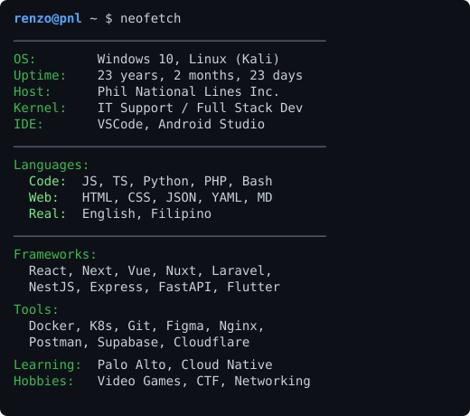

<table>
<tr>
<td align="center">

  

**John Renzo G. Dacer**

IT Support / Full Stack Developer 
Phil National Lines Inc.

</td>
<td align="center">

</td>
</tr>
</table>

─────────────────────────────────────

  

